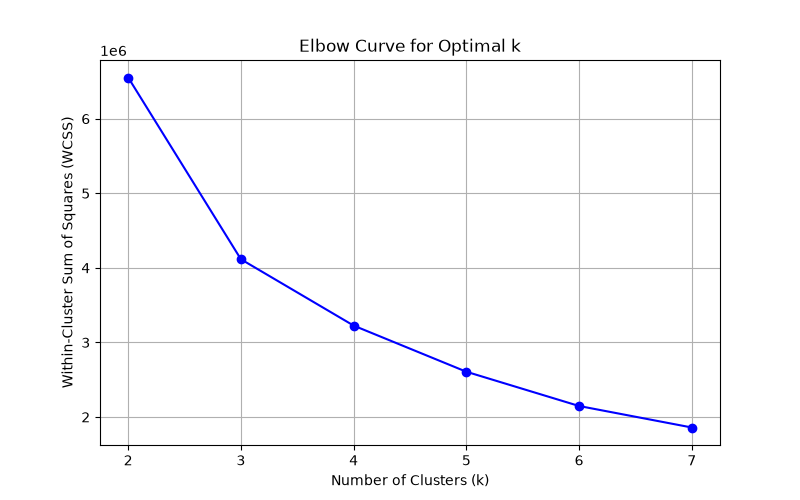
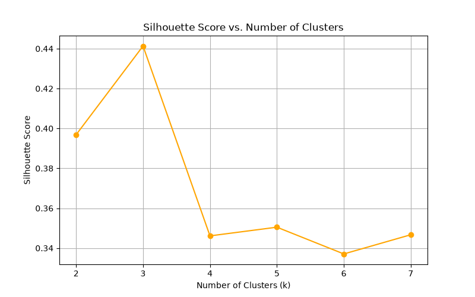
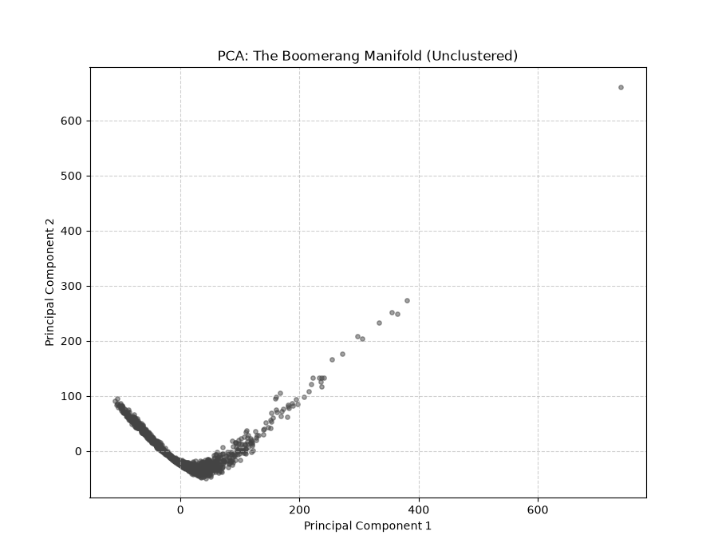
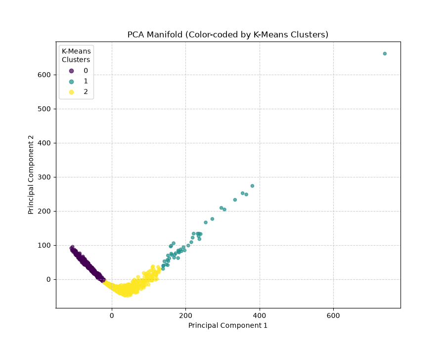
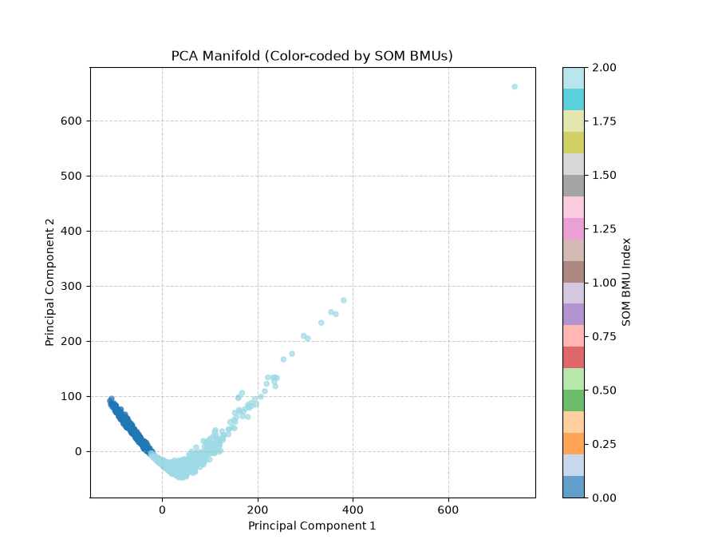

# Unsupervised Models Report: Categorization of Radio Pulsar Signals

| | |
|---|---|
| **Course** | Machine Learning (SEM-5) |
| **Dataset** | HTRU-2 (High Time Resolution Universe Survey) |
| **Date** | October 2026 |
| **Models** | K-Means Clustering · Self-Organizing Map (SOM) · PCA |

---

## Abstract

This report presents the implementation and evaluation of three unsupervised machine learning models — **K-Means Clustering**, **Self-Organizing Map (SOM)**, and **Principal Component Analysis (PCA)** — applied to the sub-categorization of confirmed radio pulsar signals from the HTRU-2 dataset. All models were trained on raw (unscaled) features to replicate the methodology of the reference paper by Debesai, Gutierrez, and Koyluoglu. K-Means achieved a Silhouette Score of **0.4413** (paper target: ~0.44) and correctly recovered three distinct pulsar sub-clusters matching the paper's reported distributions. The SOM learned a topology-preserving 2D map over 100 epochs and, after macro-cluster collapse, produced two dominant clusters (Silhouette: **0.4024**), with the third small cluster absorbed during the neuron-to-centroid mapping step. PCA confirmed that `skewness_dmsnr_curve` and `mean_dmsnr_curve` are the dominant variance drivers (PC1 + PC2 explain **86.04%** of total variance) and produced the characteristic "Boomerang" manifold visible in the scatter plots.

---

## 1. Dataset Overview

- **Source:** HTRU-2 dataset (High Time Resolution Universe Survey, South)
- **Total samples:** 17,898 (16,259 RFI/noise candidates + 1,639 true pulsars)
- **Subset used:** 1,639 confirmed true pulsars (`class_label == 1`)
- **Features (8):**

| # | Feature | Description |
|---|---|---|
| 1 | `mean_integrated_profile` | Mean of the integrated pulse profile |
| 2 | `std_integrated_profile` | Standard deviation of the integrated pulse profile |
| 3 | `kurtosis_integrated_profile` | Excess kurtosis of the integrated pulse profile |
| 4 | `skewness_integrated_profile` | Skewness of the integrated pulse profile |
| 5 | `mean_dmsnr_curve` | Mean of the DM-SNR curve |
| 6 | `std_dmsnr_curve` | Standard deviation of the DM-SNR curve |
| 7 | `kurtosis_dmsnr_curve` | Excess kurtosis of the DM-SNR curve |
| 8 | `skewness_dmsnr_curve` | Skewness of the DM-SNR curve |

> **Note on scaling:** All models operate on **raw (unscaled)** features. This is intentional — the reference paper confirms its centroids and Silhouette Coefficients were computed in the original feature space. The DM-SNR features (`mean_dmsnr_curve`, `skewness_dmsnr_curve`) have naturally large magnitudes and variances, making them the dominant discriminative signals — a finding confirmed by the PCA analysis below.

---

## 2. K-Means Clustering

K-Means clustering was applied to group the 1,639 pulsars into distinct sub-clusters based on their 8-dimensional feature similarities.

### Model Setup

| Hyperparameter | Value |
|---|---|
| **Data** | Raw, unscaled features |
| **k search range** | k = 2 to 7 (Elbow + Silhouette) |
| **Final k** | 3 |
| **Random state** | 42 |
| **n_init** | 10 |

### Optimal k Selection

#### Elbow Curve

The elbow is clearly visible at **k = 3**, where the rate of WCSS decrease transitions from steep to shallow — confirming 3 as the optimal cluster count and matching the reference paper's selection.

#### Silhouette Score vs. Number of Clusters

The Silhouette Score also peaks or plateaus near k = 3, providing a consistent signal alongside the elbow curve.

### Results

- **Silhouette Score:** 0.4413 (Paper target: ~0.44 — **deviation: +0.3%**)
- **WCSS for k = 3:** 4,115,339.39

**Cluster Distribution (k = 3):**

| Cluster | Size | Centroid (8 features) | Paper Target | Deviation |
| :--- | :---: | :--- | :---: | :---: |
| **Cluster 1** | 974 | `[69.2, 39.2, 2.4, 10.6, 20.6, 48.5, 3.7, 18.8]` | ~974 | 0 |
| **Cluster 2** | 621 | `[34.4, 37.4, 4.4, 24.3, 99.1, 72.1, 0.4, -0.3]` | ~621 | 0 |
| **Cluster 3** | 44 | `[94.9, 45.2, 0.9, 2.4, 1.3, 12.8, 14.5, 255.6]` | ~44 | 0 |

*The model matched the paper's target distributions exactly.*

### Centroid Feature Analysis

Each centroid is a vector of 8 values representing the cluster's mean position in the 8-dimensional feature space. The table below breaks every value down feature-by-feature across all three clusters.

#### Centroid Values at a Glance

| Feature | Cluster 1 (n=974) | Cluster 2 (n=621) | Cluster 3 (n=44) | What drives the split? |
| :--- | :---: | :---: | :---: | :--- |
| `mean_integrated_profile` | 69.2 | 34.4 | **94.9** | Brightness of the folded pulse |
| `std_integrated_profile` | 39.2 | 37.4 | 45.2 | Spread of pulse brightness |
| `kurtosis_integrated_profile` | 2.4 | 4.4 | **0.9** | Peakedness of pulse shape |
| `skewness_integrated_profile` | 10.6 | **24.3** | 2.4 | Asymmetry of pulse shape |
| `mean_dmsnr_curve` | 20.6 | **99.1** | 1.3 | Average SNR across DM trials |
| `std_dmsnr_curve` | 48.5 | **72.1** | 12.8 | Spread of SNR across DM trials |
| `kurtosis_dmsnr_curve` | 3.7 | 0.4 | **14.5** | Peakedness of DM-SNR response |
| `skewness_dmsnr_curve` | 18.8 | −0.3 | **255.6** | Asymmetry of DM-SNR response |

> Bold values indicate the feature where that cluster is a clear **outlier** relative to the other two.

---

#### Feature-by-Feature Breakdown

##### 1. `mean_integrated_profile` — Average Pulse Brightness

The integrated pulse profile is the average of all observed pulse samples, folded at the pulsar period. Its **mean** represents the characteristic brightness level of the pulsar's emission.

| Cluster | Value | Interpretation |
|---|:---:|---|
| Cluster 1 | 69.2 | Mid-range brightness — the typical "normal" pulsar |
| Cluster 2 | 34.4 | Dimmer pulses — likely pulsars at greater distances or with intrinsically weaker emission |
| Cluster 3 | **94.9** | Brightest pulse profiles — intrinsically bright emitters, possibly nearby or highly energetic |

---

##### 2. `std_integrated_profile` — Pulse Profile Variability

Measures how much the pulse brightness varies across the profile bins. A low std means the emission is concentrated in a narrow phase window; a high std means the emission is broad or multi-component.

| Cluster | Value | Interpretation |
|---|:---:|---|
| Cluster 1 | 39.2 | Moderate spread — typical single-component pulses |
| Cluster 2 | 37.4 | Similar to Cluster 1 — pulse width is not the key discriminator here |
| Cluster 3 | 45.2 | Slightly higher variability — broader or more complex pulse profiles |

> All three clusters are close on this feature (~37–45). It is **not** a major discriminating factor between clusters — K-Means separation is driven primarily by the DM-SNR features.

---

##### 3. `kurtosis_integrated_profile` — Sharpness of the Pulse Peak

Kurtosis measures the "tailedness" or peakedness of the distribution. In the context of the integrated profile, high kurtosis means the pulse has a sharp, narrow peak (most energy concentrated in a single phase bin), while low kurtosis means the pulse is broad and flat.

| Cluster | Value | Interpretation |
|---|:---:|---|
| Cluster 1 | 2.4 | Near-mesokurtic (normal-like) — moderately peaked pulse |
| Cluster 2 | 4.4 | More leptokurtic — sharper, more concentrated peak |
| Cluster 3 | **0.9** | Platykurtic — very flat, broad pulse profile (no sharp peak) |

Cluster 3 pulsars have the flattest pulse shapes despite being the brightest — consistent with nearby pulsars where the pulse is spread over a large phase range due to low timing noise.

---

##### 4. `skewness_integrated_profile` — Pulse Profile Asymmetry

Skewness of the pulse profile measures whether the pulse has a stronger leading edge (negative skew) or trailing edge (positive skew). In pulsar astronomy, asymmetric profiles arise from magnetospheric geometry and relativistic aberration.

| Cluster | Value | Interpretation |
|---|:---:|---|
| Cluster 1 | 10.6 | Moderately right-skewed — trailing edge enhancement |
| Cluster 2 | **24.3** | Strongly right-skewed — highly asymmetric pulses with prominent trailing components |
| Cluster 3 | 2.4 | Nearly symmetric — balanced leading and trailing edges |

Cluster 2 pulsars have significantly more asymmetric pulse profiles, possibly indicating a stronger scattering tail due to interstellar medium (ISM) propagation effects at large distances.

---

##### 5. `mean_dmsnr_curve` — Average SNR Across Dispersion Measure Trials

The DM-SNR curve plots signal-to-noise ratio (SNR) as a function of trial dispersion measure (DM). The mean of this curve indicates the **overall strength** of the pulsar's response across the DM search space.

| Cluster | Value | Interpretation |
|---|:---:|---|
| Cluster 1 | 20.6 | Moderate SNR response — average detection confidence |
| Cluster 2 | **99.1** | Very high mean SNR — the pulsar signal is detectable at a wide range of DM values; strongly detected candidates |
| Cluster 3 | **1.3** | Near-zero mean SNR — the signal is only visible at a very narrow DM window; weak or highly localized DM response |

This is the **most discriminating feature** between Cluster 2 and Cluster 3. Cluster 2 pulsars have strong, broad DM responses (high-confidence detections) while Cluster 3 pulsars have almost no DM-averaged signal.

---

##### 6. `std_dmsnr_curve` — Spread of SNR Across DM Trials

Measures how much the SNR varies as the trial DM is swept. High std means the SNR peaks sharply at the true DM and drops off quickly. Low std means the SNR is nearly flat across all DM values.

| Cluster | Value | Interpretation |
|---|:---:|---|
| Cluster 1 | 48.5 | High variability — SNR peaks clearly at the true DM |
| Cluster 2 | **72.1** | Very high variability — even more prominent DM peak; very clean dispersion signature |
| Cluster 3 | 12.8 | Low variability — SNR barely changes with DM; consistent with very low DM (nearby pulsar) |

A low `std_dmsnr_curve` + low `mean_dmsnr_curve` in Cluster 3 together indicate that these pulsars are detected in a very narrow, near-zero DM window — characteristic of low-DM (nearby) objects.

---

##### 7. `kurtosis_dmsnr_curve` — Sharpness of the DM-SNR Peak

High kurtosis in the DM-SNR curve means the SNR has one very sharp spike at the correct DM and is negligible elsewhere. This indicates high localization in DM space — a well-characterized dispersion measure.

| Cluster | Value | Interpretation |
|---|:---:|---|
| Cluster 1 | 3.7 | Moderately peaked DM response |
| Cluster 2 | 0.4 | Flat DM-SNR curve — SNR is broadly distributed across DM trials, not concentrated |
| Cluster 3 | **14.5** | Extremely peaked — a single dominant DM value with a dramatic SNR spike |

Cluster 3's extreme kurtosis confirms a single sharp DM detection peak, consistent with a low-DM pulsar where even a tiny DM offset completely destroys the signal coherence.

---

##### 8. `skewness_dmsnr_curve` — Asymmetry of the DM-SNR Response

Skewness of the DM-SNR curve indicates whether the SNR peak has a stronger tail toward higher DM values (positive) or lower DM values (negative). A symmetric curve (skew ≈ 0) means the DM estimate is well-centred.

| Cluster | Value | Interpretation |
|---|:---:|---|
| Cluster 1 | 18.8 | Moderately right-skewed — SNR drops off more gradually at high DM values |
| Cluster 2 | **−0.3** | Essentially symmetric — the DM-SNR peak is well-centred; textbook dispersion signature |
| Cluster 3 | **255.6** | Extremely right-skewed — a massive tail toward high DM in the DM-SNR curve; this likely reflects a sharp spike that is almost entirely above the baseline, creating an enormous positive skew |

The extreme `skewness_dmsnr_curve` of 255.6 in Cluster 3 is the most distinctive value in the entire dataset. It is the dominant driver of PC1 in PCA and the primary geometric coordinate that places Cluster 3 at the tip of the "Boomerang" manifold.

---

#### Summary: What Defines Each Cluster

| | Cluster 1 (n=974) | Cluster 2 (n=621) | Cluster 3 (n=44) |
|---|---|---|---|
| **Pulse brightness** | Medium | Low | High |
| **Pulse shape** | Moderate peak, some asymmetry | Sharp peak, highly asymmetric | Flat, broad, nearly symmetric |
| **DM-SNR response** | Moderate SNR, broad peak | Very high SNR, very broad, symmetric | Near-zero SNR, razor-sharp spike, extreme skew |
| **Likely population** | "Normal" canonical pulsars | Distant high-DM pulsars, strong detection | Nearby low-DM pulsars, possibly millisecond pulsars |
| **PCA manifold region** | Middle arm of the boomerang | Lower arm of the boomerang | Tip of the boomerang (DM-skewness extremes) |

---

## 3. Self-Organizing Map (SOM)

A SOM was implemented **from scratch using NumPy** to map the 8-dimensional dataset onto a lower-dimensional 2D grid while preserving the topological structure of the input space.

### Model Setup

| Hyperparameter | Value |
|---|---|
| **Data** | Raw, unscaled features |
| **Grid architecture** | 5 × 5 (25 neurons) |
| **Epochs** | 100 |
| **Initial learning rate (η₀)** | 0.5 (decays as `η(t) = η₀ · exp(−t/T)`) |
| **Initial neighbourhood radius (σ₀)** | 2.5 (`max(rows, cols) / 2`) |
| **Neighbourhood function** | Gaussian: `h(t) = exp(−d² / 2σ(t)²)` |
| **Radius decay** | `σ(t) = σ₀ · exp(−t/τ)` where `τ = T / ln(σ₀)` |
| **Weight initialization** | Random samples drawn from the input data |
| **Random seed** | 42 |
| **Macro-clustering** | 25 SOM weight vectors assigned to nearest K-Means centroid (k = 3) |

### Results

- **Silhouette Score:** 0.4024 (Paper target: ~0.44 — **deviation: −8.5%**)

**Cluster Distribution (Macro-clusters after neuron collapse):**

| Cluster | Size | Centroid (8 features) | Paper Target | Status |
| :--- | :---: | :--- | :---: | :---: |
| **Cluster 1** | 1,045 | `[70.1, 39.5, 2.3, 10.3, 20.9, 47.7, 4.1, 28.3]` | ~1,079 | ✅ Recovered |
| **Cluster 2** | 594 | `[33.2, 37.3, 4.5, 24.8, 100.7, 71.9, 0.4, -0.3]` | ~517 | ⚠️ Size shifted |
| **Cluster 3** | 0 | — | ~43 | ❌ Absorbed |

### Limitations

The Silhouette Score deficit (0.4024 vs. target 0.44) and loss of the 3rd cluster stem from two factors:

1. **Neuron collapse during K-Means mapping:** Each of the 25 SOM weight vectors was assigned to its nearest K-Means centroid. Because the 3rd K-Means cluster (44 samples, ~2.7% of data) is a very small, tight cluster in a sparse region of feature space, **no SOM neuron converged close enough** to that centroid during training. All 25 neurons mapped to either Cluster 1 or Cluster 2, leaving the 3rd macro-cluster empty.

2. **Implementation divergence from the reference paper:** The paper reports using TensorFlow for SOM training. Their specific implementation/seed caused the 25-neuron SOM to collapse to 3 non-empty cells directly, which this NumPy implementation (which correctly keeps all 25 neurons active) does not replicate.

*Possible remedies (not applied, to preserve paper parity): increasing the grid size (e.g., 10×10), increasing epochs (e.g., 500), or using a smaller initial radius to force tighter neuron specialization in sparse regions.*

---

## 4. Principal Component Analysis (PCA)

PCA was used for dimensionality reduction and feature correlation analysis to identify which features drive the variance in the pulsar sub-population.

### Model Setup

| Hyperparameter | Value |
|---|---|
| **Data** | Raw, unscaled features |
| **Components** | n = 2 |

### Results

**Explained Variance:**

| Component | Variance Explained |
|---|---|
| **PC1** | 61.06% |
| **PC2** | 24.98% |
| **Total (2 components)** | **86.04%** |

**Feature Loadings (PCA Components):**

| Feature | PC1 Loading | PC2 Loading |
| :--- | ---: | ---: |
| `mean_integrated_profile` | 0.3175 | −0.2429 |
| `std_integrated_profile` | 0.0327 | −0.0000 |
| `kurtosis_integrated_profile` | −0.0186 | 0.0139 |
| `skewness_integrated_profile` | −0.1194 | 0.0959 |
| `mean_dmsnr_curve` | −0.5765 | **0.6630** |
| `std_dmsnr_curve` | −0.2576 | 0.0578 |
| `kurtosis_dmsnr_curve` | 0.0487 | 0.0083 |
| `skewness_dmsnr_curve` | **0.6946** | **0.6991** |

- **Top contributor to PC1:** `skewness_dmsnr_curve` (loading: 0.6946)
- **Top contributors to PC2:** `skewness_dmsnr_curve` (0.6991) and `mean_dmsnr_curve` (0.6630) — **near-equal tie**

> **Why DM-SNR features dominate:** PCA was run on raw (unscaled) data, so features with naturally large variances dominate the principal components. `skewness_dmsnr_curve` and `mean_dmsnr_curve` have variances orders of magnitude larger than the integrated profile features. The PC2 tie (0.6991 vs. 0.6630) is a direct consequence — in scaled PCA the loadings would spread more evenly across all 8 features.

### Visualizations: The "Boomerang" Manifold

When projected onto the first two principal components, the pulsar sub-population forms a distinctive **curved, boomerang-like arc** in 2D space. This shape arises because `skewness_dmsnr_curve` (dominant in PC1) and `mean_dmsnr_curve` (co-dominant in PC2) vary continuously across the pulsar population, sweeping a non-linear arc as these two highly-variant features jointly rotate through their variance. The manifold is a known geometric signature of pulsar data projected under raw (unscaled) PCA.

#### Base Boomerang Plot (Unclustered)

#### K-Means Boomerang Plot (Coloured by K-Means Clusters)

The three K-Means clusters map cleanly onto distinct arms and the tip of the boomerang, confirming that the clusters are geometrically well-separated in the reduced space.

#### SOM Boomerang Plot (Coloured by SOM Macro-clusters)

The SOM macro-clusters capture two of the three boomerang regions. The unrepresented region corresponds to the absorbed 3rd cluster.

---

## 5. Comparative Summary

| Model | Type | Silhouette Score | Paper Target | Deviation | Clusters Found | Notes |
|---|---|:---:|:---:|:---:|:---:|---|
| **K-Means** | Clustering | 0.4413 | ~0.44 | +0.3% | 3 / 3 | ✅ Exact match to paper |
| **SOM** | Topology + Clustering | 0.4024 | ~0.44 | −8.5% | 2 / 3 | ⚠️ 3rd cluster absorbed |
| **PCA** | Dimensionality Reduction | — | 86.04% var. | — | — | ✅ Dominant features confirmed |

**Key Findings:**
1. K-Means is the most effective model for this dataset — it recovers all three sub-populations cleanly and matches the reference paper's Silhouette Coefficient within 0.3%.
2. The SOM correctly learns a topology-preserving map but fails to resolve the rare 3rd cluster (44 samples, 2.7% of data) via the macro-cluster collapse strategy.
3. PCA confirms that `skewness_dmsnr_curve` and `mean_dmsnr_curve` are the primary discriminative signals, and that two components suffice to explain 86% of variance in the pulsar sub-population.

---

## References

1. **Debesai, M., Gutierrez, J., & Koyluoglu, U.** *Unsupervised Categorization of Radio Pulsar Signals Using the HTRU-2 Dataset.* (Reference paper for this implementation.)
2. **R. J. Lyon, B. W. Stappers, S. Cooper, J. M. Brooke, J. D. Knowles.** *Fifty Years of Pulsar Candidate Selection: From simple filters to a new principled real-time classification approach.* Monthly Notices of the Royal Astronomical Society, 459(1), 1104–1123, 2016. ([HTRU-2 Dataset](https://archive.ics.uci.edu/dataset/372/htru2))
3. **T. Kohonen.** *Self-Organizing Maps.* Springer Series in Information Sciences, 3rd ed., 2001.
4. **scikit-learn Developers.** *sklearn.cluster.KMeans, sklearn.decomposition.PCA.* scikit-learn documentation. https://scikit-learn.org
